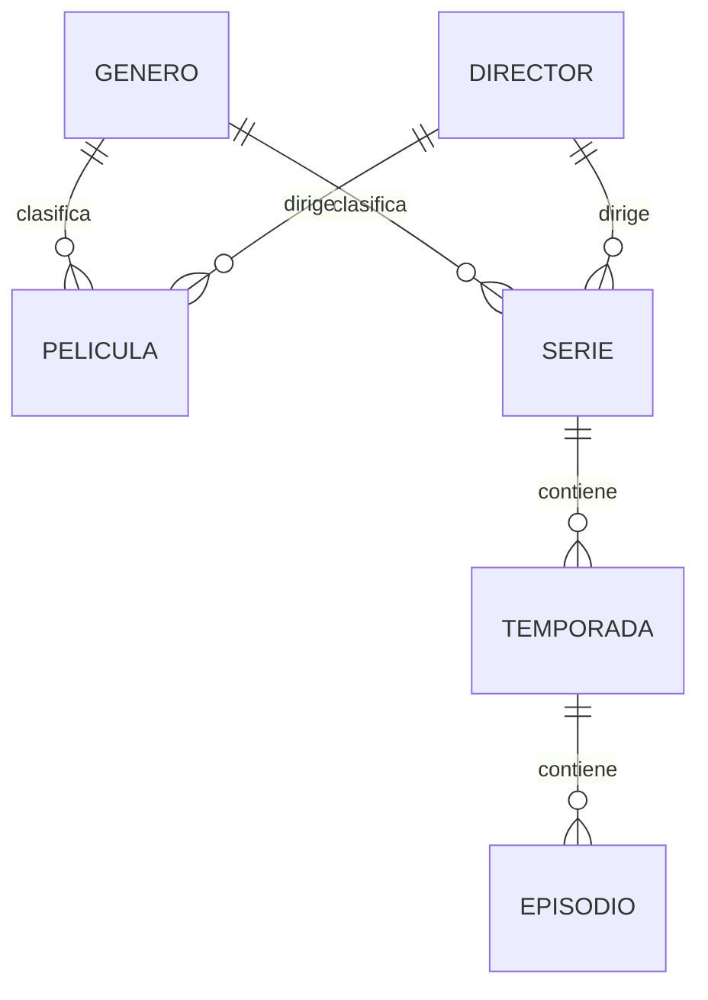

# Guía de estudio y ejecución · Evaluación 2 Backend

## 1. Qué estás construyendo

TitanStream será un **catálogo persistente de películas y series**. Podrás guardar, listar, consultar, modificar y eliminar datos mediante HTTP. No es un servicio de reproducción de video ni necesita cuentas de clientes para cumplir este alcance.

Tu versión original tenía una página inicial con una lista escrita a mano en `views.py`. `models.py` y `admin.py` estaban vacíos; no había migraciones de la aplicación, serializers, ViewSets, rutas REST ni SQL. El enlace `/catalogo` no tenía una vista y la clave secreta estaba escrita en `settings.py`.

La versión preparada mantiene la identidad visual, hace que la página lea películas de la base de datos y añade la API completa del catálogo. Se tomó del ejemplo del profesor el patrón **ModelSerializer + ModelViewSet + DefaultRouter**, adaptado a tus entidades.

Los documentos de evaluación piden CRUD con GET, POST, PUT, PATCH y DELETE, migraciones, SQL para base/usuario/permisos, variables de entorno, historial Git y una defensa individual de cinco preguntas. No proporcionan el diseño específico de tu catálogo; confirmaste que puedes definirlo. Este diseño es una propuesta que debes comprender y poder justificar, no una garantía de nota.

## 2. Diseño de datos: seis entidades

| Modelo | Qué representa | Campos principales |
|---|---|---|
| Genero | Clasificación principal | nombre único, descripción opcional |
| Director | Director principal | nombre, nacionalidad opcional |
| Pelicula | Obra independiente | título, sinopsis, fecha, duración, género, director |
| Serie | Obra dividida en temporadas | título, sinopsis, fecha, finalizada, género, director |
| Temporada | Parte de una serie | serie, número, título opcional |
| Episodio | Capítulo de una temporada | temporada, número, título, sinopsis, duración |



**Decisión de alcance:** cada película/serie tiene un género principal y un director principal. Un catálogo con varios géneros o codirectores necesitaría relaciones muchos a muchos. No se añadieron esas relaciones para mantener una implementación inicial manejable.

Django crea automáticamente un `id` entero para cada registro. Una clave foránea guarda el ID del registro relacionado. Por ejemplo, `genero: 3` significa que la película pertenece al género cuyo ID es 3; no al tercer elemento visible de una lista.

El par `(serie, numero)` es único en Temporada: dos series distintas pueden tener temporada 1, pero una misma serie no puede tener dos temporadas 1. Lo mismo ocurre con `(temporada, numero)` en Episodio.

## 3. Preparar el proyecto en tu equipo

### 3.1. Trabajar sin perder tu historial

Si ya tienes el repositorio clonado, abre su carpeta en VS Code. Revisa `git status` antes de traer cambios; conserva cualquier trabajo local pendiente. Si necesitas clonarlo por primera vez:

```powershell
git clone https://github.com/keepreal-oss/PROYECTO_API_PELICULAS_SERIES.git
cd PROYECTO_API_PELICULAS_SERIES
```

La implementación se preparó en la rama `evaluacion-2-api`. Si esa rama ya fue publicada en tu remoto, puedes traerla con:

```powershell
git fetch origin
git switch evaluacion-2-api
```

Si recibiste la versión como archivos descargados, copia su contenido en tu clon y conserva tu carpeta `.git`. No necesitas ejecutar `git init` de nuevo. No copies entornos virtuales de otra computadora.

### 3.2. Crear el ambiente virtual

En la terminal PowerShell de VS Code, ubicada junto a `manage.py`:

```powershell
py -3.12 --version
py -3.12 -m venv .venv
.\.venv\Scripts\python.exe -m pip install --upgrade pip
.\.venv\Scripts\python.exe -m pip install -r requirements.txt
```

Usar la ruta del ejecutable evita depender de la activación de PowerShell. Si prefieres activarlo, ejecuta `.\.venv\Scripts\Activate.ps1`; después podrás escribir simplemente `python`.

Si `py -3.12` no existe, instala Python 3.12 o selecciona una instalación compatible y revisa su versión. No es necesario cambiar la política de ejecución para usar directamente `.venv\Scripts\python.exe`.

`requirements.txt` fija las dependencias principales: Django 5.2.18, DRF 3.16.1, python-decouple 3.8 y mysqlclient 2.2.8. Se normalizó el archivo a UTF-8 y se eligió una combinación que permite trabajar con Python 3.12. La instalación de mysqlclient depende de las bibliotecas/wheels disponibles en tu sistema.

En Linux, el entorno se crea con `python3 -m venv .venv`; el ejecutable es `.venv/bin/python`. Para compilar mysqlclient suelen requerirse las cabeceras de Python/MySQL, compilador y `pkg-config`. No reemplaces el driver por otro sin adaptar y comprobar la configuración.

### 3.3. Crear MySQL, usuario y permisos

Inicia el servicio de MySQL y abre MySQL Workbench con una cuenta administradora. La configuración presupone MySQL local y el puerto 3306; si usas otro puerto, cámbialo en `.env`.

Abre `sql/01_crear_base_datos.sql`. En una copia local, reemplaza `CAMBIAR_CLAVE_LOCAL` por una contraseña de desarrollo que tú elijas. Ejecuta el archivo. Contiene:

```sql
CREATE DATABASE titanstream CHARACTER SET utf8mb4 COLLATE utf8mb4_unicode_ci;
CREATE USER 'titanstream_app'@'localhost' IDENTIFIED BY 'CAMBIAR_CLAVE_LOCAL';
GRANT ALL PRIVILEGES ON titanstream.* TO 'titanstream_app'@'localhost';
```

La primera sentencia crea la base vacía; la segunda crea una cuenta; la tercera le da permisos solamente sobre esa base. **Esto todavía no crea las tablas del catálogo:** las creará `migrate`.

No subas la copia con la contraseña real. El archivo del repositorio debe conservar el marcador. No repitas `CREATE USER` si el usuario ya existe: revisa la cuenta y la contraseña con tu administrador. No borres bases para solucionar ese error.

### 3.4. Crear las variables de entorno

Ejecuta una sola vez:

```powershell
.\.venv\Scripts\python.exe scripts/crear_env.py
```

Escribe la misma contraseña que pusiste en MySQL. No se muestra mientras escribes. El script genera `.env` junto a `manage.py`, con una `SECRET_KEY` aleatoria y las variables de conexión.

Abre `.env` y comprueba nombre, usuario, host y puerto; si tu conexión difiere, ajústalos. `.env.example` muestra todos los nombres sin secretos. No hace falta crear un `.env` manual además del generado.

`settings.py` utiliza:

```python
from decouple import config
SECRET_KEY = config('SECRET_KEY')
DEBUG = config('DEBUG', default=False, cast=bool)
```

`config()` consulta primero las variables del proceso y después el archivo `.env`. `cast=bool` convierte el texto `True` o `False` en un booleano. Una variable de conexión ya definida en la terminal puede prevalecer sobre `.env`.

El archivo `.env` está en `.gitignore`. La evaluación pide disponer de él: muéstralo en tu ambiente local y entrégalo por el canal privado indicado por tu profesor, si lo solicita. No lo publiques con credenciales reales. La clave que aparecía en tu versión original ya no debe utilizarse; el script crea una nueva, aunque la antigua siga en el historial.

### 3.5. Crear las tablas e iniciar

```powershell
.\.venv\Scripts\python.exe manage.py check
.\.venv\Scripts\python.exe manage.py migrate
.\.venv\Scripts\python.exe manage.py showmigrations peliculas_series
.\.venv\Scripts\python.exe manage.py createsuperuser
.\.venv\Scripts\python.exe manage.py runserver
```

Debes ver `[X] 0001_initial` en `showmigrations`. El superusuario sirve para entrar a `/admin/`; no es el usuario de MySQL. Son cuentas distintas con propósitos distintos.

Abre http://127.0.0.1:8000/ y http://127.0.0.1:8000/api/. La portada estará vacía hasta que guardes películas. `DEBUG=True` es para el trabajo local y permite servir los estilos durante el desarrollo. La página personalizada 404 se usa con `DEBUG=False`.

Para datos de muestra puedes ejecutar `manage.py loaddata demo` **una sola vez sobre un catálogo vacío**. La fixture usa IDs fijos, por lo que volver a cargarla puede reemplazar datos. Los datos de muestra son ficticios; también puedes omitirla y seguir el ejercicio de la sección 5.

## 4. Comprender el código, archivo por archivo

### 4.1. Modelo: `peliculas_series/models.py`

```python
class Pelicula(models.Model):
    titulo = models.CharField(max_length=150)
    sinopsis = models.TextField(blank=True)
    fecha_estreno = models.DateField()
    duracion_minutos = models.PositiveIntegerField(validators=[MinValueValidator(1)])
    genero = models.ForeignKey(Genero, on_delete=models.PROTECT, related_name="peliculas")
    director = models.ForeignKey(Director, on_delete=models.PROTECT, related_name="peliculas")
    created_at = models.DateTimeField(auto_now_add=True)
    updated_at = models.DateTimeField(auto_now=True)
```

- `models.Model`: Django administra esta clase como una tabla mediante su ORM.
- `CharField`: texto corto con límite; `TextField`: texto más largo.
- `blank=True`: permite omitir la sinopsis en la validación. Para texto usamos cadena vacía; no necesitamos `null=True`.
- `DateField`: fecha con formato de entrada `YYYY-MM-DD`.
- `MinValueValidator(1)`: la duración debe ser al menos un minuto. Un entero positivo por sí solo también permite cero.
- `ForeignKey`: relación de muchos registros hacia uno. Antes de crear la película deben existir su género y director.
- `PROTECT`: impide borrar un género/director que aún tiene películas o series.
- `auto_now_add`: fecha de creación; `auto_now`: fecha de la última modificación.
- `__str__`: etiqueta legible en el administrador.

Para Serie → Temporada y Temporada → Episodio usamos `CASCADE`: borrar una serie borra sus temporadas y episodios. Esta es una decisión deliberada para no dejar capítulos sin serie. Antes de demostrar DELETE, crea datos descartables.

### 4.2. Migraciones

`makemigrations` compara los modelos con el historial de migraciones y crea archivos Python con cambios de esquema. `migrate` aplica esos cambios a la base seleccionada en settings.

La migración inicial ya está incluida. Para instalar el proyecto solo necesitas `migrate`. Cuando **tú cambies un modelo** posteriormente:

```powershell
.\.venv\Scripts\python.exe manage.py makemigrations
.\.venv\Scripts\python.exe manage.py migrate
```

Sube las migraciones a Git junto con el cambio del modelo. No borres migraciones para ocultar errores. Las migraciones no son los registros del catálogo: esos se crean mediante API, admin o una fixture.

### 4.3. Serializers: `peliculas_series/serializers.py`

```python
class PeliculaSerializer(serializers.ModelSerializer):
    class Meta:
        model = Pelicula
        fields = ["id", "titulo", "sinopsis", "fecha_estreno", "duracion_minutos",
                  "genero", "director", "created_at", "updated_at"]
        read_only_fields = ["created_at", "updated_at"]
```

El serializer transforma un objeto en datos que DRF puede renderizar como JSON. En sentido contrario valida los datos recibidos antes de crear o actualizar el objeto. `Meta.model` indica el modelo y `fields` define lo que expone la API. `id` es de solo lectura automáticamente; las fechas se generan en el servidor.

Los campos relacionados reciben IDs; el serializer comprueba que existan. Los validadores de Temporada/Episodio devuelven HTTP 400 si se repite el número dentro del mismo padre. Las restricciones en `Meta.constraints` también protegen esa unicidad en la base de datos.

### 4.4. ViewSets: `peliculas_series/views.py`

```python
class PeliculaViewSet(CatalogoViewSet):
    queryset = Pelicula.objects.select_related("genero", "director").all()
    serializer_class = PeliculaSerializer
```

`queryset` determina qué registros consulta; `serializer_class` determina cómo los valida y presenta. `select_related` obtiene relaciones de clave foránea en la misma consulta cuando se necesitan, por ejemplo en representaciones de objetos.

`CatalogoViewSet` hereda de `viewsets.ModelViewSet`. Los seis ViewSets heredan de esa clase común, así que **sí utilizan ModelViewSet**. Este aporta `list`, `retrieve`, `create`, `update`, `partial_update` y `destroy`. La clase común únicamente personaliza el borrado protegido: responde 409 con un mensaje en vez de propagar una excepción como error del servidor.

La función `bienvenida()` sigue renderizando HTML, pero ahora consulta `Pelicula.objects` y cuenta las series/películas reales.

### 4.5. Router y URLs

En `peliculas_series/urls.py`:

```python
router = DefaultRouter()
router.register("peliculas", views.PeliculaViewSet)
urlpatterns = [path("", include(router.urls))]
```

En `motor_django/urls.py`:

```python
path("api/", include("peliculas_series.urls"))
```

La combinación produce `/api/peliculas/` y `/api/peliculas/7/`. El router distingue una colección de un registro concreto y conecta cada verbo HTTP con la acción del ViewSet. Usa siempre la barra `/` final.

### 4.6. Admin y settings

`admin.site.register([...])` habilita los seis modelos en el administrador de Django. El admin pertenece a Django y no reemplaza tu API REST.

`INSTALLED_APPS` contiene `peliculas_series` y `rest_framework`. `DATABASES` utiliza el backend MySQL y obtiene la conexión desde `.env`. El ORM utilizado es el de Django; no necesitas SQLAlchemy para estos modelos.

La configuración de pruebas `test_settings.py` sustituye la base por SQLite en memoria y usa valores ficticios. Solo se activa con `--settings=motor_django.test_settings`; **no la uses para demostrar persistencia de tu entrega**. La API está abierta para la práctica local (`AllowAny`); antes de publicarla en Internet habría que definir autenticación y permisos.

## 5. Practicar CRUD de verdad

### 5.1. Crear registros en orden

Puedes usar Postman: método **POST**, pestaña **Body → raw → JSON**, URL local. También puedes usar el formulario de la API navegable. Usa estos datos ficticios y conserva el ID que devuelva cada POST; **no supongas que será 1**.

1. POST `http://127.0.0.1:8000/api/generos/`

```json
{"nombre":"Aventura de práctica","descripcion":"Datos para la defensa"}
```

2. POST `/api/directores/`

```json
{"nombre":"Camila Torres (demo)","nacionalidad":"Chile"}
```

3. POST `/api/peliculas/`. Reemplaza `genero` y `director` por los IDs reales:

```json
{"titulo":"Horizonte azul","sinopsis":"Una expedición ficticia.","fecha_estreno":"2024-06-10","duracion_minutos":105,"genero":1,"director":1}
```

4. POST `/api/series/`, usando tus IDs de género/director:

```json
{"titulo":"Rutas del sur","sinopsis":"Serie de práctica.","fecha_estreno":"2024-07-01","finalizada":false,"genero":1,"director":1}
```

5. POST `/api/temporadas/`, usando el ID de la serie creada:

```json
{"serie":1,"numero":1,"titulo":"El comienzo"}
```

6. POST `/api/episodios/`, usando el ID de la temporada creada:

```json
{"temporada":1,"numero":1,"titulo":"La partida","sinopsis":"Primer capítulo.","duracion_minutos":42}
```

Cada creación debe responder **201 Created**. Los archivos de `docs/api_ejemplos.http` permiten repetir estas peticiones con una extensión REST Client; los IDs al inicio de ese archivo también se deben ajustar.

### 5.2. Los cinco métodos con una película

| Operación | Petición | Resultado esperado |
|---|---|---|
| Listar | GET `/api/peliculas/` | 200 y lista JSON |
| Consultar una | GET `/api/peliculas/{id}/` | 200 y objeto JSON |
| Crear | POST `/api/peliculas/` con los datos | 201 y nuevo ID |
| Actualizar con PUT | PUT `/api/peliculas/{id}/` | 200; enviar todos los campos obligatorios |
| Actualizar parcialmente | PATCH `/api/peliculas/{id}/` | 200; enviar solo lo que cambias |
| Eliminar | DELETE `/api/peliculas/{id}/` | 204 sin cuerpo |

Para PUT, envía el JSON de creación completo, cambiando por ejemplo el título y la duración. No envíes solo el título: faltarán los campos obligatorios. En DRF los campos opcionales omitidos pueden conservar su valor; no describas PUT como un borrado automático de todos los opcionales.

Para PATCH basta:

```json
{"duracion_minutos":120}
```

Después de DELETE, un GET a ese ID debe responder **404**. Repite el ciclo con cada entidad: la rúbrica evalúa todo el modelo, no solo Pelicula.

### 5.3. Ejercicio en PowerShell sin IDs fijos

Con el servidor en otra terminal, copia por bloques. Crea registros nuevos y borra únicamente la película que acaba de crear:

```powershell
$base = 'http://127.0.0.1:8000/api'
$genero = Invoke-RestMethod -Method Post -Uri "$base/generos/" -ContentType 'application/json' -Body (@{nombre="Practica-$([guid]::NewGuid().ToString('N').Substring(0,8))"} | ConvertTo-Json)
$director = Invoke-RestMethod -Method Post -Uri "$base/directores/" -ContentType 'application/json' -Body (@{nombre='Director de practica'} | ConvertTo-Json)
$datos = @{titulo='Viaje de prueba'; sinopsis='Demo'; fecha_estreno='2024-01-01'; duracion_minutos=90; genero=$genero.id; director=$director.id}
$pelicula = Invoke-RestMethod -Method Post -Uri "$base/peliculas/" -ContentType 'application/json' -Body ($datos | ConvertTo-Json)
$detalle = "$base/peliculas/$($pelicula.id)/"
Invoke-RestMethod -Method Get -Uri $detalle
$datos.titulo = 'Viaje actualizado'
Invoke-RestMethod -Method Put -Uri $detalle -ContentType 'application/json' -Body ($datos | ConvertTo-Json)
Invoke-RestMethod -Method Patch -Uri $detalle -ContentType 'application/json' -Body '{"duracion_minutos":100}'
Invoke-RestMethod -Method Delete -Uri $detalle
```

El género y el director de práctica permanecen. Puedes eliminarlos después de verificar que no tienen otros registros asociados.

### 5.4. Mostrar errores controlados

- Duración 0 o negativa → 400; no se crea la película.
- Género inexistente → 400; la relación no es válida.
- Repetir el número de temporada en la misma serie → 400.
- Borrar un género/director utilizado → 409. Primero cambia o elimina los registros dependientes si de verdad quieres borrarlo.
- Borrar una serie → 204 y eliminación en cascada de sus temporadas y episodios.

## 6. Verificar antes de entregar

Pruebas rápidas aisladas:

```powershell
.\.venv\Scripts\python.exe manage.py test --settings=motor_django.test_settings -v 2
.\.venv\Scripts\python.exe manage.py makemigrations --check --dry-run --settings=motor_django.test_settings
```

Se comprobaron **18 tests**, que incluyen todos los métodos para los seis recursos, validación, protección/cascada, portada, 404 y carga de la fixture. Pasaron con SQLite temporal y Python 3.12.14. Eso verifica la lógica, pero no la conexión MySQL de tu PC.

Para la entrega ejecuta además en tu MySQL local:

```powershell
.\.venv\Scripts\python.exe manage.py check
.\.venv\Scripts\python.exe manage.py migrate
.\.venv\Scripts\python.exe manage.py showmigrations
```

Si quieres correr los mismos tests sobre MySQL, ejecuta `sql/02_permisos_pruebas.sql` como administrador y luego `manage.py test -v 2` sin el argumento `--settings`. Django creará y destruirá `test_titanstream`, sin usar las tablas del catálogo normal como base de pruebas.

Demuestra persistencia creando una película por API, deteniendo y reiniciando `runserver`, y consultando de nuevo su ID. También puedes localizarla en MySQL Workbench mediante `SELECT * FROM peliculas_series_pelicula;`.

## 7. Preparar GitHub

Revisa los cambios antes de subirlos:

```powershell
git status
git diff
git check-ignore .env
```

El último comando debe mostrar `.env` cuando exista. La clave real no debe aparecer en `settings.py`, en SQL ni en un archivo agregado al commit. Las migraciones, la plantilla `.env.example`, SQL con marcadores, código y documentación sí deben versionarse.

Si estás aplicando cambios localmente, crea commits con mensajes que describan trabajo real; no inventes un historial para aparentar etapas:

```powershell
git add .
git diff --cached --stat
git commit -m "Implementa API REST del catalogo y guia de evaluacion"
git push -u origin evaluacion-2-api
```

Si la rama ya contiene los commits publicados, no necesitas volver a copiarlos ni hacer un commit vacío. Revisa la solicitud de cambios y fusiónala cuando entiendas el resultado. Entrega la URL y la rama solicitadas por el profesor.

## 8. Defensa individual: cinco preguntas principales

**1. ¿Qué hace un serializer en tu proyecto?**
Convierte los objetos del catálogo en datos de respuesta y valida los datos de entrada. Mi `PeliculaSerializer` define sus campos y verifica tipos, campos obligatorios y existencia de género/director antes de guardar.

**2. ¿Por qué usas ModelViewSet?**
Porque reúne las operaciones de listar, consultar, crear, actualizar completa/parcialmente y eliminar. Mis ViewSets indican queryset y serializer; heredan de una clase común que a su vez hereda de ModelViewSet y controla los borrados protegidos.

**3. ¿Cuál es la diferencia entre makemigrations y migrate?**
El primero genera archivos que describen cambios de los modelos. El segundo aplica esos archivos a la base de datos. Tener `0001_initial.py` no basta: debo demostrar que está aplicada con `[X]`.

**4. ¿Cuál es la diferencia entre PUT y PATCH?**
PUT valida una actualización no parcial y exige todos los campos obligatorios de entrada. PATCH modifica solo los campos enviados. En mi API puedo cambiar únicamente `duracion_minutos` con PATCH.

**5. ¿Cómo relacionaste las entidades y qué ocurre al borrar?**
Películas y series apuntan a un género y un director por claves foráneas protegidas. Una serie contiene temporadas y cada temporada episodios. Esas dos últimas relaciones usan CASCADE, por lo que borrar una serie borra sus temporadas y episodios.

Practica también: ¿para qué sirve `.env`?, ¿qué genera un router?, ¿qué es un endpoint?, ¿por qué 201 frente a 200?, ¿qué significa 204?, ¿por qué una relación usa un ID?, ¿por qué `blank` y `null` no son lo mismo?, ¿qué hace el ORM?, ¿qué demuestra Git?, ¿cómo sabes que los datos persisten?

## 9. Ensayo de presentación de 8 a 10 minutos

1. Explica el alcance del catálogo y sus seis entidades; señala las relaciones en el diagrama.
2. Muestra `settings.py`, `.env.example` y SQL sin revelar contraseñas.
3. Muestra las migraciones aplicadas y los modelos en `/admin/`.
4. Sigue una petición de película por URL, router, ViewSet, serializer y modelo.
5. Haz POST, GET, PUT, PATCH y DELETE con un registro descartable. Muestra al menos un registro y la ruta de cada una de las otras entidades.
6. Demuestra una validación fallida y explica el código de respuesta.
7. Muestra los tests y tu historial Git; responde las cinco preguntas sin leer el código de memoria.

## 10. Lista de entrega y problemas frecuentes

| Criterio | Evidencia que debes mostrar |
|---|---|
| Entorno y estructura | `.venv` local, dependencias instaladas, proyecto/app |
| Modelo completo | Seis clases, relaciones y diagrama |
| Registro | Seis modelos en admin |
| Migraciones | Archivo inicial y `[X]` en showmigrations |
| DRF instalado/configurado | requirements y `INSTALLED_APPS` |
| Serialización y vistas | Seis serializers y seis ViewSets |
| URLs integradas | Router y `/api/` accesible |
| Inicio y CRUD | Portada, API, métodos y persistencia en MySQL |
| SQL y entorno | Scripts, `.env` local y `.env.example` versionado |
| GitHub | Commits reales y URL accesible |
| Defensa | Explicación propia de cinco temas |

**`UndefinedValueError: SECRET_KEY` o `DB_NAME`:** falta `.env` junto a `manage.py`, tiene otro nombre como `.env.txt` o no contiene la variable. Ejecuta el script o corrige el archivo.

**MySQL `Access denied`:** revisa usuario, contraseña, host y los permisos. No uses la clave del superusuario Django como contraseña MySQL por confusión.

**`Unknown database` / conexión rechazada:** ejecuta el SQL o inicia el servicio MySQL y revisa el puerto.

**Tabla inexistente:** ejecuta `migrate` con la configuración de MySQL, no con la de tests.

**Error al instalar mysqlclient:** confirma que usas Python compatible; el mensaje indicará si necesita herramientas de compilación o bibliotecas del sistema. `requirements-test.txt` permite estudiar y probar la lógica, pero no sustituye la instalación MySQL exigida.

**404 en API:** usa `/api/peliculas/`, no `/peliculas` ni una ruta sin barra final. Un ID borrado también devuelve 404.

**409 al borrar género/director:** es la protección esperada; no un fallo de CRUD.

**Página 404 de desarrollo en vez de tu diseño:** usa `DEBUG=False` para mostrar el template personalizado; durante desarrollo deja `DEBUG=True` para ver errores y estilos locales.

**No puedes activar PowerShell:** usa directamente `.\.venv\Scripts\python.exe`, como en esta guía.
